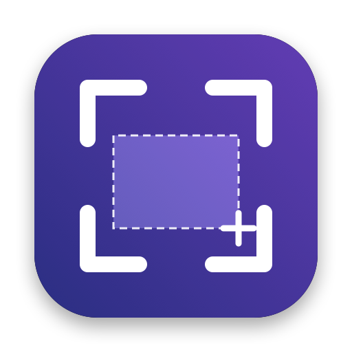

<p align="center">
  
</p>

<h1 align="center">MacShot</h1>

<p align="center">
  <strong>ShareX-style screenshots for the Mac — freeze, select, annotate, done.</strong><br>
  <sub>A native menu bar app: frozen-screen region capture, window and scrolling capture, an annotation editor and after-capture tasks.<br>Built with ScreenCaptureKit and AppKit. No account, no cloud, nothing leaves your Mac.</sub>
</p>

<p align="center">
  <a href="https://github.com/mucahitimre/MacShot/releases"></a>
  <a href="https://github.com/mucahitimre/MacShot/actions/workflows/ci.yml"></a>
  
  
  <a href="LICENSE"></a>
</p>

<p align="center">
  <a href="CHANGELOG.md">Changelog</a> · <a href="RELEASING.md">Releasing</a> · <a href="docs/manual-test.md">Manual tests</a> · <a href="docs/plan.md">Original plan</a>
</p>

<!-- Hero screenshot: docs/images/screenshot.png (capture toolbar over a neutral page) -->

---

## Why MacShot

macOS's built-in screenshots are good, but if you came from ShareX you miss things:

- ✗ The screen keeps moving while you select — menus close, hovers disappear
- ✗ No "do this after every capture" pipeline (save, copy, reveal, annotate)
- ✗ No way to grab the same region again with one shortcut
- ✗ No scrolling screenshots of long pages
- ✗ Annotating means opening another app

## The Solution

**Press ⌘⇧X.** The screen freezes instantly, you select a region (or click a window), and MacShot runs your after-capture tasks — all from the menu bar, all local.

| | |
|---|---|
| 🧊 **Frozen screen** | Every display is captured first; you select on a still image, so menus and hover states stay put |
| 🎯 **Pixel-accurate regions** | Magnifier, arrow-key nudging, size labels, square selection, move and resize until Enter |
| 🪟 **Window & screen modes** | Hover highlights a window with the camera cursor, click to capture — like macOS, plus detection in region mode |
| 📜 **Scrolling capture** | Long pages stitched into one image; automatic scrolling that stops at the end and never takes over your mouse |
| ✏️ **Annotation editor** | Arrow, rectangle, text, pixelate, numbered steps — native toolbar, undo/redo, share |
| ⚡ **After-capture tasks** | Save, copy (PNG + TIFF), show in Finder, notify — in order, each failure isolated |
| 🔁 **Last region** | Remembered across relaunches; ⌥⇧5 captures it again without the overlay |
| 🖼️ **Floating thumbnail** | Click to annotate, drag into any app, swipe to dismiss |
| ⏱️ **Self-timer & sound** | 5 / 10 second timer, system shutter sound |
| 🍎 **Native** | Follows macOS's own screenshot UI, light and dark mode, Reduce Motion |

## Install

Download the latest `MacShot-x.y.z.dmg` from [Releases](https://github.com/mucahitimre/MacShot/releases), drag MacShot to Applications and open it. Release builds are signed with a Developer ID and notarized by Apple. On first launch MacShot asks for Screen Recording permission (see [Permission](#permission)).

There are two builds: the **GitHub build** (Developer ID, not sandboxed) supports automatic scrolling in scrolling capture; a future **App Store build** is sandboxed and offers manual scrolling only, because macOS does not let sandboxed apps receive the Accessibility permission.

Requires macOS 14.0 or later.

## Build from source

```bash
brew install xcodegen
cp Config/Local.xcconfig.example Config/Local.xcconfig   # your Team ID and bundle id prefix
xcodegen generate
xcodebuild -project MacShot.xcodeproj -scheme MacShot -derivedDataPath build/DD build
open build/DD/Build/Products/Debug/MacShot.app
```

- Xcode 16+ (Swift 6, strict concurrency).
- Configurations: Debug / Release are the GitHub channel (`Sources/MacShot/MacShot.entitlements`, not sandboxed); `AppStore` is sandboxed (`MacShot-AppStore.entitlements`). Preferences from earlier sandboxed builds are migrated once on first launch.
- Signing: set `DEVELOPMENT_TEAM` and `BUNDLE_ID_PREFIX` in `Config/Local.xcconfig` (gitignored). Repository defaults live in `Config/Signing.xcconfig` (empty team, `com.example`). Ad-hoc signed builds lose the Screen Recording permission on every rebuild, so use a stable Apple Development identity. Changing the bundle id prefix also resets the permission.
- The app name comes from `APP_NAME` in `project.yml`; the bundle id is `$(BUNDLE_ID_PREFIX).$(APP_NAME:lower)`.

## Test

```bash
xcodebuild -project MacShot.xcodeproj -scheme MacShot -derivedDataPath build/DD test
```

Pure logic (geometry, selection state machine, file naming, last region decisions, window detection, annotations) lives in the `MacShotCore` framework and is tested without a host app.

In Debug builds, `open build/DD/Build/Products/Debug/MacShot.app --args -MacShotEditorSample` opens the annotation editor with a sample image (no capture permission needed), `--args -MacShotShowWindows` opens Settings and onboarding, and `--args -MacShotRegionSelfTest` logs whether region capture matches a crop of a full snapshot, `--args -MacShotAutoScrollProbe` checks whether synthetic scrolling works, and `--args -MacShotScrollingSelfTest` runs a scrolling capture on the area under the mouse (frames are kept in `~/Pictures/MacShot/selftest-frames/`).

Manual test checklist: [docs/manual-test.md](docs/manual-test.md)

## Usage

| Shortcut | Action |
|---|---|
| ⌘⇧X | Capture region: screens freeze, select a region |
| ⌥⇧5 | Capture last region: captures the last region without opening the overlay |

Shortcuts can be changed in Settings. The overlay opens with a toolbar at the bottom of the screen, modeled on macOS's own screenshot toolbar:

- **Modes:** Capture Entire Screen (click a screen), Capture Selected Window (hover highlights a window, click captures it), Capture Selected Portion (drag a region), Capture Scrolling Region (see below).
- **Options:** save location, after-capture tasks, self-timer (5 / 10 seconds: choose on the frozen frame, captured live after the countdown), floating thumbnail, remember last selection, magnifier, quick capture, window detection, sound.
- **Capture** (same as Enter) and **Close** (same as Esc).

After a capture a thumbnail appears in the bottom-right corner for a few seconds: click it to annotate (the saved file is replaced), drag it into another app, swipe right to dismiss, or right-click for more.

**Scrolling capture** (toolbar mode, menu > Capture Scrolling Region, or a shortcut you assign in Settings): select the area to capture — for example the content part of a browser window — and press Capture. A dashed frame marks the area.

- **Automatic** (GitHub build, after allowing Accessibility in Settings › General › Permissions): keep the pointer inside the frame; MacShot scrolls by itself and stops at the end of the content. Moving the mouse, scrolling, clicking or pressing a key hands control back to you, Esc cancels, and it never runs longer than 45 seconds / 120 frames. It never moves your pointer.
- **Manual** (no permission, or the App Store build): scroll down slowly inside the frame while MacShot captures and stitches the frames, then click **Done** in the panel below the frame. "Scroll for Me…" in the panel asks for the permission.
 Sticky headers and footers are kept once, a fixed sidebar is left out (the result is cropped to the part that scrolls), and scroll bars, hover effects and re-rendered text antialiasing are tolerated when matching frames. If you scroll too far at once the panel asks you to scroll back a little.

Keys inside the overlay:

| Key / mouse | Action |
|---|---|
| Drag | Select. With quick capture off (default) the selection stays: drag inside to move it, use the 8 handles to resize |
| Click on a window | Window detection: the window under the cursor is highlighted, clicking selects it (can be turned off) |
| Enter / double-click inside | Capture and run the selected after-capture tasks |
| ⌘C | Capture to the **clipboard only** (after-capture tasks are skipped) |
| Esc / right-click | Cancel; no file, clipboard unchanged |
| Shift (while drawing) | Square |
| ⌥ (while drawing) | Move the selection |
| Arrow / Shift+Arrow | Move the cursor or selection by 1 / 10 pixels |
| Delete | Clear the selection |
| Space | All screens (one file per screen) |
| ~ / ` | The screen under the cursor |
| 1 … 9, 0 | The whole screen with that number (system screen order; 0 = tenth) |
| Mouse wheel | Magnifier size (7…31 pixels, remembered) |

**After-capture tasks** (menu > After capture, or Settings) run in this order: annotation editor → save to file → copy to clipboard (PNG + TIFF, optionally the file URL) → show in Finder → notification (with thumbnail; clicking it reveals the file). Default: save + clipboard. If one task fails the others still run, and failures are summarized in a single notification. Files go to `~/Pictures/MacShot/yyyy-MM/Screenshot_yyyy-MM-dd_HH-mm-ss.png`; the folder can be changed in Settings (security-scoped bookmark, falls back to the default if it becomes inaccessible).

**Last region:** after every region capture the display UUID and rect are stored (kept across relaunches). The region overlay shows it as a faint dashed outline; Enter accepts it. If the display is gone or the rect no longer fits, ⌥⇧5 opens the overlay with "Last region is not valid for this display layout". Window captures (clicking a detected window without changing it) and Space / ~ captures do not change the last region; only drawn regions are remembered.

### Annotation editor

When the "Open annotation editor" task is selected, the capture opens in the editor first and the other tasks run on the edited image (skipped for multi-screen captures).

| Shortcut | Action |
|---|---|
| A / R / T / B / N | Arrow / rectangle / text / pixelate / number badge |
| ⌘Z / ⇧⌘Z | Undo / redo |
| Enter / ⌘S / Done | Run the tasks |
| ⌘C / Copy | Clipboard only |
| Esc / close window | Cancel (image discarded) |

The editor uses a native unified toolbar: tools, color and line width menus, undo/redo, Share, Copy and Done. Annotations are stored in image pixels and drawn by the same code on screen and in the output.

## Permission

On first launch MacShot asks for Screen Recording permission: in the onboarding window use **Request permission → Open System Settings → Relaunch app**. macOS may cache the permission result for the lifetime of the process, so the relaunch is required. Without permission, or when a capture fails, no blank or wallpaper-only image is saved. macOS Sequoia and later may ask to confirm the permission again periodically; that is expected.

## Hotkey caveat

On macOS 15.0–15.1, sandboxed apps could not register shortcuts that use only Option or Option+Shift (`-9868`, fixed in 15.2). KeyboardShortcuts does not report registration failures, so MacShot probes the same combination through Carbon at launch; if it fails, Settings shows a warning and a one-click fallback (⌃⇧4 / ⌃⇧5). Shortcuts may not fire while secure input is active (e.g. in a password field).

## Architecture

```
Sources/MacShotCore/   pure logic, tested without a host app
  CaptureGeometry        global ↔ display-local ↔ pixel ↔ Quartz, rounding, clamping
  SelectionStateMachine  overlay mouse/keyboard behavior
  AfterCapture           task set + failure-isolating runner
  LastRegion             model, UserDefaults store, validity decision
  WindowSnap             window rects (Quartz → display-local), hit testing
  CaptureMode            selection / window / screen / scrolling modes, self-timer
  ScrollStitcher         strip signatures, sticky bands, column band, shift matching, ScrollingCapture
  AutoScrollPolicy       safety rules for automatic scrolling
  Annotation             model, undo/redo, CoreGraphics/CoreText renderer
  FileNamer, ImageCropper (PNGEncoder), HotkeyRegistration
Sources/MacShot/
  App/         AppDelegate, menu bar, hotkeys, preferences
  Capture/     ScreenSnapshotService (ScreenCaptureKit), RegionCapturer, ScrollingSession, WindowList, CaptureCoordinator
  Overlay/     one NSPanel per screen, OverlayView, MagnifierView, CaptureToolbar, Countdown
  Editor/      annotation editor (model, canvas, window)
  Output/      CaptureOutput, Clipboard, SaveFolder, Notifier, ThumbnailPanel
  Settings/    tabbed settings (General / Capture / After Capture / Shortcuts), LoginItem (SMAppService)
  Onboarding/  permission flow
```

Freeze: on the hotkey all screens are captured in parallel with `SCScreenshotManager`, and the overlay is shown only afterwards; the crop comes from that frozen frame, there is no second capture. The legacy `CGWindowListCreateImage` is not used. Window detection uses `CGWindowListCopyWindowInfo` only to read window bounds and z-order (it captures no pixels); the Dock's full-screen transparent window (layer 20) and the menu bar are ignored.

## Known limitations

- No selection spanning multiple screens; the selection is clamped to the screen where it started.
- Only window detection, no control (button etc.) detection.
- Drawn annotations cannot be selected, moved or deleted individually; use undo.
- The self-timer and scrolling capture take live frames, so they are the paths that do not use the frozen frame.
- Scrolling capture needs overlapping content between frames; an area that is entirely blank while you scroll past it cannot be matched (the frame is skipped).
- Automatic scrolling needs the Accessibility permission and is only available in the GitHub (non-sandboxed) build.
- Launch at login also works for Debug builds under `build/`, but moving the app requires re-enabling it; install into `/Applications` for regular use.

## Roadmap

- [ ] Signed and notarized releases on GitHub (Developer ID)
- [ ] Mac App Store build (sandboxed, manual scrolling) — see [docs/app-store.md](docs/app-store.md)
- [ ] Selecting, moving and deleting individual annotations
- [ ] Selections spanning several displays
- [ ] Control (button) detection next to window detection

## Releasing

Every stable version is tagged `vX.Y.Z` and published as a signed, notarized DMG and ZIP on GitHub Releases. See [RELEASING.md](RELEASING.md). Mac App Store distribution is evaluated in [docs/app-store.md](docs/app-store.md).

## Contributing and license

- Guide: [CONTRIBUTING.md](CONTRIBUTING.md) · Code of conduct: [CODE_OF_CONDUCT.md](CODE_OF_CONDUCT.md) · Security: [SECURITY.md](SECURITY.md)
- CI (GitHub Actions): unsigned build + tests and a legacy capture API check on every push and pull request.
- No ShareX (GPL-3.0) code was copied; only its behavior served as a reference.
- License: [MIT](LICENSE) © 2026 Mücahit İmre
